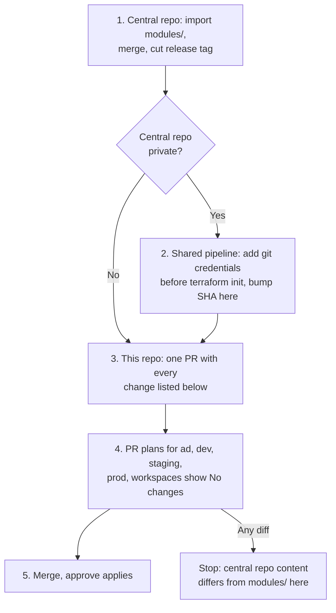

# Module migration to the central repository

Everything under `modules/` is moving to the central module repository,
`pbs-common/<central-modules-repo>`. This repository will then contain only environment root
modules, entrypoint workflows, CI coverage tooling, and the MGN agent scripts.

Until the cutover, coordinate any significant module changes so they are not lost in the move.

## Modules moving

All eight directories move. Only the `source` line in each caller changes; module names, inputs,
and outputs stay the same.

| Module | Callers in this repo | Notes |
|---|---|---|
| `backup` | `ad`, `dev`, `staging`, `prod`, `workspaces` | |
| `cloudwatch-alerts` | `ad`, `dev`, `staging`, `prod`, `workspaces` | Includes `lambda/webhook_forwarder.py` |
| `config` | `ad`, `dev`, `staging`, `prod`, `workspaces` | Includes `ec2_alarm_check.py` |
| `ec2-workload` | `ad` (2 calls) | |
| `instance-alarms` | `ad`, `dev`, `staging`, `prod`, `workspaces` (one call per instance) | |
| `managed-prefix-list` | `ad` | |
| `ssm-session-access-policy` | `ad` | Has no README; add one in the central repo |
| `mgn-organizations-delegation` | `org-delegation` | |

To list every call site: `grep -rn 'source *= *"../../modules/' environments/`

## Cutover sequence



1. **Central repo.** Copy each `modules/<name>/` directory unchanged, including the `lambda/` and
   `.py` files. To keep history, use `git filter-repo --path modules/` on a clone of this repo
   and merge the result into the central repo. Cut a release tag (for example `v1.0.0`) from the
   commit that matches `main` here.
2. **Private-repo access, if needed.** This repo is public, so the CI `GITHUB_TOKEN` cannot read a
   private central repo, and `terraform init` will fail to download the modules. If the central
   repo is private, the `terraform-plan.yaml` and `terraform-apply.yaml` reusable workflows in
   `terraform-aws-shared-ghpipeline` need a step before `init` that configures Git credentials
   with read access to it (GitHub App token or deploy key). Then bump the pinned SHA in every
   entrypoint workflow here. Skip this step if the central repo is public or internal and
   readable by this repo.
3. **Single PR in this repo** containing every change in
   [Changes in this repository](#changes-in-this-repository). Do not split it: the coverage
   checker fails while `modules/` and the workflow filters disagree.
4. **Verify zero drift.** The PR touches every `environments/*/main.tf`, so all five pipelines
   plan. Each plan must report `No changes.` The module addresses (`module.<name>`) do not
   change, so no `moved` blocks or state operations are needed. Any diff means the tagged
   central-repo content does not match `modules/` here; fix the central repo, re-tag, and
   re-plan.
5. **Merge.** Approve each environment's apply. Applies are no-ops if step 4 passed.

`environments/org-delegation` is not connected to the deployment pipelines. It must be deployed
manually from a workstation with valid credentials for the organization management account.

## Changes in this repository

### Module sources: `environments/*/main.tf`

Replace every relative source with a Git source pinned to the release tag. Use the `//` subdirectory
separator and `?ref=` ([Terraform module sources](https://developer.hashicorp.com/terraform/language/modules/sources#generic-git-repository)).

```hcl
# Before
module "backup" {
  source = "../../modules/backup"
  # ...
}

# After
module "backup" {
  source = "git::https://github.com/pbs-common/<central-modules-repo>.git//modules/backup?ref=v1.0.0"
  # ...
}
```

- Pin to a tag or a full commit SHA. Never use a branch name.
- Pin every call in an environment to the same ref.
- Files: `ad/main.tf`, `dev/main.tf`, `staging/main.tf`, `prod/main.tf`, `workspaces/main.tf`,
  `org-delegation/main.tf`.

### Entrypoint workflows: `ad.yaml`, `dev.yaml`, `staging.yaml`, `prod.yaml`, `workspaces.yaml`

- Delete every `"modules/<name>/**"` entry from **both** `push.paths` and `pull_request.paths`.
  The two lists must remain identical.
- Remove the comment above the `push` filter saying every consumed module must appear there.
- If step 2 applies, bump the `terraform-aws-shared-ghpipeline` SHA on the `validate`, `plan`,
  and `apply` jobs.

### Coverage checker: `.github/scripts/check_terraform_ci_coverage.py`

- `TF_ROOTS = ("environments", "modules")` becomes `TF_ROOTS = ("environments",)`. If you leave it
  as is, the check fails with `inventory root modules/ does not exist`.
- Remove `module_dependencies()` and check 3 ("a planned environment filters on the modules it
  consumes"). They match only `"../../modules/` sources, so after the move they find nothing.
- Review check 7 ("every directory is linted directly") and the module-specific text in the
  docstrings and failure messages. Module linting moves to the central repo's CI.

### Checker self-test: `.github/scripts/test_check_terraform_ci_coverage.py`

- Stop copying `modules` into the fixture repo (`for name in (".github", "environments",
  "modules")`).
- Remove or rewrite the tests that create, delete, or filter on `modules/*` directories (for
  example `brand-new-module`, `unconsumed`, `late-arrival`, `renamed-away`, the nested
  `ec2-workload/submodule` test, and the empty-`modules/` tests). Keep the pure `matches()` and
  `covers_dir()` pattern tests, or change their example paths to `environments/`.
- Run both scripts locally before pushing:
  `python .github/scripts/test_check_terraform_ci_coverage.py && python .github/scripts/check_terraform_ci_coverage.py`

### Exclusions: `.github/terraform-ci-coverage-exclusions.json`

- Delete the `modules/mgn-organizations-delegation` entry. Check 5 fails on an exclusion whose
  directory no longer exists.
- Keep the `environments/org-delegation` entry.

### Lint: `.tflint.hcl` and `ci-coverage.yaml`

- No change needed. `call_module_type = "local"` means tflint does not inspect remote modules
  from the environment directories, so linting module code now happens only in the central
  repo's CI. Confirm that CI exists before cutover.

### Other files

| File | Change |
|---|---|
| `modules/` | Delete the whole directory |
| `.gitignore` | Remove the `modules/cloudwatch-alerts/lambda/webhook_forwarder.zip` line and its comment |
| `README.md` | Directory tree, the module consumption text and table, the "a module it consumes" trigger row, CI coverage step 2, the `modules/*/README.md` related-docs link, the upcoming-migration callout, and the "Planned migration: modules" section |
| `.github/workflows/README.md` | "Coverage: every Terraform directory is linted" (dependency check and module linting) and "Adding a pipeline for a new environment" step about module path filters |
| `docs/migration.md` (this file) | Delete once the cutover is complete, or keep as a record |

## Behaviour after the move

- **Module changes no longer trigger plans here.** An environment picks up a module change only
  when someone bumps its `?ref=` in a PR here, which then plans as usual.
- **Module-only rollback** is a PR that changes `?ref=` back to the previous tag.
- **The Lambda build steps still work.** `cloudwatch-alerts` and `config` zip their Python source
  from `${path.module}` in a `local-exec` provisioner. `path.module` now resolves inside
  `.terraform/modules/`, where `terraform init` downloads the module, so the zip is built there.
  The `null_resource` triggers depend on bucket and key, not on the path, so the source change
  does not force a re-upload.
